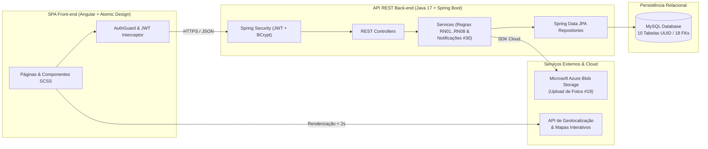
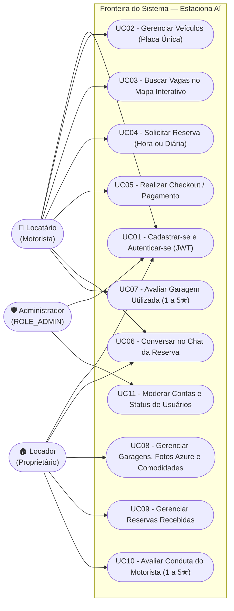
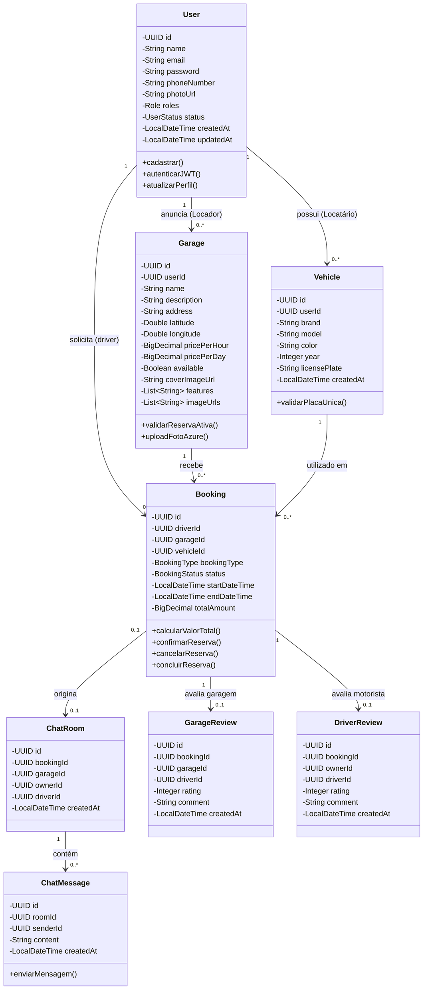
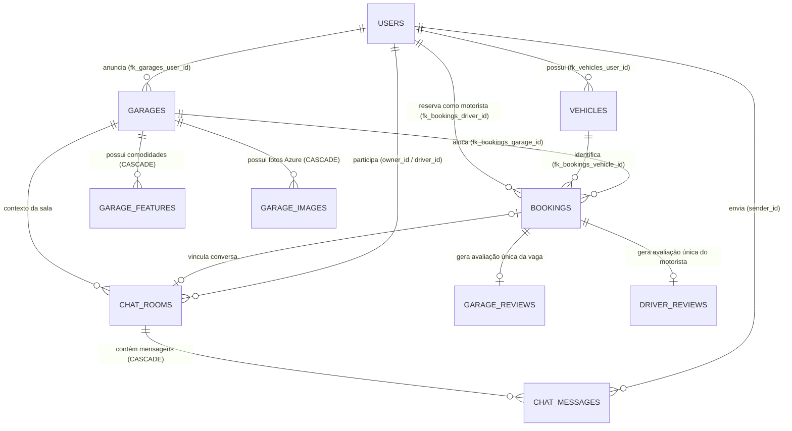
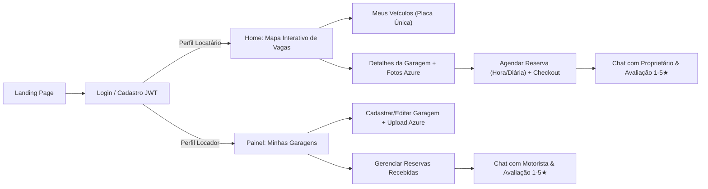

# 05 — Arquitetura de Software, Diagramas UML e Banco de Dados

> Documentação arquitetural completa do **Estaciona Aí**, reunindo a organização em camadas, os Diagramas de Casos de Uso e de Classes (renderizados nativamente no GitHub via Mermaid), o Modelo Lógico Relacional corrigido (10 tabelas e 18 Foreign Keys) e o Fluxo de Telas.

## 1. Visão Arquitetural (Front-end, Back-end e Cloud)

## 2. Diagrama de Casos de Uso (UML)

## 3. Diagrama de Classes UML (Domínio Back-end Spring Boot)

## 4. Modelo Lógico Relacional (DER — 10 Tabelas e 18 Foreign Keys)

## 5. Fluxo de Navegação de Telas (User Flow — SPA Angular)

